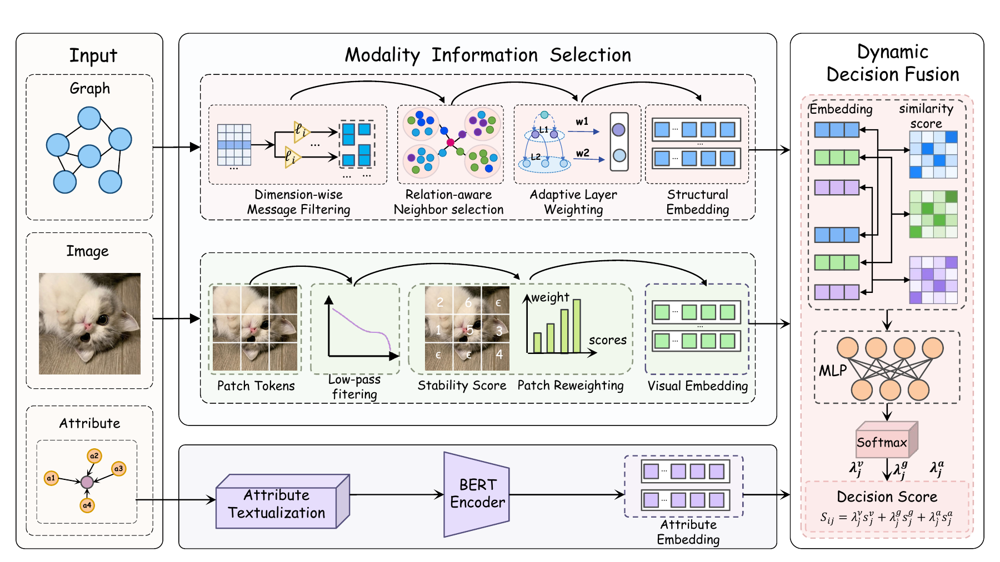

# ETA：模态内筛选，模态间融合

**Select Within, Fuse Across: Reliable Decision Fusion for Multi-Modal Entity Alignment**

[English](README.md) · [框架图 PDF](assets/framework.pdf) · [数据说明](docs/DATASETS.md) · [复现指南](docs/REPRODUCIBILITY.md)

ETA 面向多模态实体对齐任务，识别不同知识图谱中指向同一现实对象的实体。我们先在各模态内部筛选有判别力的信息，再针对候选实体对动态融合图结构、属性与视觉模态的对齐分数。



## 工作简介

- **图结构模态：**通过逐维消息过滤、关系感知的邻居加权和带先验正则的自适应传播层加权，改善实体的结构表示。
- **视觉模态：**通过高斯低通滤波前后的特征变化衡量局部图像块的稳定性，并据此对图像块重新加权。
- **属性模态：**将属性名称与取值文本化，使用 BERT 提取表示。
- **决策融合：**通过 MLP 门控网络，为每个候选实体对生成模态权重，融合各模态的对齐分数。

论文涉及五个基准数据集。**本次公开版本提供 FB15K-DB15K 和 FB15K-YAGO15K 两组数据的代码、预处理数据与视觉特征**，支持 20%、50%、80% 对齐种子比例下的非迭代实验和伪标签实验。DBP15K 的三个语言对实验、基线、消融和案例分析不包含在当前版本中。

## 安装与运行

参考环境：Linux/WSL、Bash、Python 3.8.20、PyTorch 2.4.1、CUDA 12.1，以及 NVIDIA GPU。

```bash
git clone https://github.com/leoi1999/ETA.git
cd ETA
conda create -n eta python=3.8.20 -y
conda activate eta
python -m pip install --upgrade pip
python -m pip install -r requirements-cu121.txt
python tools/download_data.py

# 将完整 BERT 模型下载到本地
python -c "from huggingface_hub import snapshot_download; snapshot_download(repo_id='google-bert/bert-base-uncased', local_dir='pretrained_models/bert')"

# 首次执行时自动生成缺失的属性特征，再训练四个阶段
bash scripts/run_main.sh FB_DB 0.2
```

默认使用已提供的视觉特征，无需另外下载原始图片或 CLIP。训练日志、配置和模型检查点默认保存在 `logs/main_normvotes/`。

## 数据集下载

**[下载 ETA 预处理数据包](https://github.com/leoi1999/ETA/releases/download/data-v1/eta-data-v1.zip)**，或运行 `python tools/download_data.py` 自动下载、校验并解压。数据包包括两组数据的图三元组、实体映射、原始属性、对齐划分和视觉特征。

| 数据集 | 命令参数 | 种子比例 |
| --- | --- | --- |
| FB15K-DB15K | `FB_DB` | `0.2` / `0.5` / `0.8` |
| FB15K-YAGO15K | `FB_YAGO` | `0.2` / `0.5` / `0.8` |

原始数据来源：[MMKG/MMKB](https://github.com/mniepert/mmkb)、[数据归档](https://doi.org/10.5281/zenodo.1245698)、[MMEA](https://github.com/liyichen-cly/MMEA)。论文涉及的多模态 DBP15K 资源可参考 [MEAformer](https://github.com/zjukg/MEAformer#-dataset) 与 [EVA](https://github.com/cambridgeltl/eva#data)，但不能直接替代本版本的预处理文件。

更多数据统计、文件格式和预训练模型准备方式见[数据说明](docs/DATASETS.md)与[复现指南](docs/REPRODUCIBILITY.md)。数据包不包含原始图像、属性特征、预训练权重或训练完成的 ETA 检查点。

## 更多实验

```bash
# 其他数据集、比例与 GPU
bash scripts/run_main.sh FB_YAGO 0.5
GPU=1 bash scripts/run_main.sh FB_DB 0.8

# 只查看运行命令，不启动训练
bash scripts/run_main.sh FB_DB 0.2 --dry-run
bash scripts/run_pseudo.sh FB_YAGO 0.2 --dry-run

# 属性特征准备完成后，运行伪标签实验
bash scripts/run_pseudo.sh FB_DB 0.2
```

非迭代脚本使用已有的监督集/开发集划分；伪标签脚本重新生成训练集、验证集和测试集，按验证集选择模型后评估融合模型的测试集结果。比较实验结果时请核对[评测协议](docs/REPRODUCIBILITY.md#evaluation-protocols)。

## 引用与反馈

仓库引用见 [CITATION.bib](CITATION.bib)。本版本未填写尚未提供的论文作者、发表会议、期刊或 DOI。数据来源和参考项目见 [ACKNOWLEDGMENTS.md](ACKNOWLEDGMENTS.md)。使用问题请提交到 [GitHub Issues](https://github.com/leoi1999/ETA/issues)。
